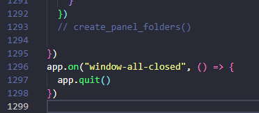

#первые шаги в архитектуре и рефакторинге sqllite
Итак второй этап "первые шаги в архитектуре и sqllite  рефакториг"
именно этап стал для меня первым серьёзным рубежом на пути моего инженерного развития 
начнем по с архитектуры  здесь впервые она впервые появляется на серьёзном уровне 
потому что пришли sqllite потоки да и функционала стало кратно больше что что само, интуитивно толкает к порядку 
предлагаю взглянуть на архитектору  и v1
```
├── backend/             # Бизнес-логика, модели данных и точка входа Node.js
│   ├── main.js                    # Точка входа в backend 
│   ├── apps.js                    # Управление модулем приложений 
│   ├── cotegory.js                # Категории заметок 
│   ├── folders.js                 # Управление структурой папок
│   ├── grubs.js                    # Группировка данных (apps, folders, scripts )
│   ├── notes.js                   # Логика работы с заметками
│   └── scripts.js                 # Управление внешними/внутренними скриптами
│
├── main_process_hendlers/         # Слой IPC-обработчиков (IPC Handlers)
│   ├── apps_hendler.js            # Обработка событий IPC для приложений
│   ├── dataBase_hendler.js        # IPC-запросы взаимодействия с БД
│   ├── folders_hendler.js         # IPC-запросы для работы с папками
│   ├── get_hotkey.js              # Регистрация и обработка глобальных горячих клавиш
│   ├── file_data_hendler.js       # Обработчики данных файлов (file_data_handler)
│   ├── notes_hendler.js           # IPC-запросы для работы с заметками
│   └── scripts_hendler.js         # IPC-запросы для выполнения скриптов
│
├── servis/                        # Фоновые службы, воркеры и утилиты
│   ├── bot.js                     # Интеграция с ботом / сторонними сервисами
│   ├── data.json                  # Статические конфигурации и данные
│   ├── openFolder.js              # Вызов системных команд открытия папок в ОС
│   └── open_folder_worker.js      # Фоновый Worker для асинхронных операций с папками
│
├── frontend/ # Интерфейс пользователя (UI, HTML/CSS, JS)
│
├── index.js точка входа electron приложение 
```

то есть был выделены  четкие слои `backend, main_process_hendlers, servis, frontend `
появились явные границы ответственности  
благодаря архитектуре кратно улучшались  иаштабируймость , читаемость и быстродействие системы за счет потоков   

переходим к sqllite
ранее все хранилось в json   а теперь есть sqllite  что кратно упрощает  и ускоряет всё
да возможно это незаметно  когда у вас 10 запесей а будь их 100 ? 1000? тогда будет жопа 
так же в отличие от json, sqllite:
1)позволяет контролировать данные их тип без костылей
2)отлично работает с большим объёмом данных
3)из коробки поддерживает crud  

```sql
CREATE TABLE IF NOT EXISTS categories (
        id INTEGER PRIMARY KEY AUTOINCREMENT,
        name TEXT NOT NULL UNIQUE
        )
   CREATE TABLE IF NOT EXISTS folders_grub (
            id INTEGER PRIMARY KEY AUTOINCREMENT,
            name TEXT NOT NULL UNIQUE
            )
            
      CREATE TABLE IF NOT EXISTS apps_grub (
        id INTEGER PRIMARY KEY AUTOINCREMENT,
        name TEXT NOT NULL UNIQUE
    )
      CREATE TABLE IF NOT EXISTS scrips_grub (
        id INTEGER PRIMARY KEY AUTOINCREMENT,
        name TEXT NOT NULL UNIQUE
    )
    
      CREATE TABLE IF NOT EXISTS notes (
        id INTEGER PRIMARY KEY AUTOINCREMENT,
        title TEXT NOT NULL,
        content TEXT,
        category_id INTEGER,
        created_at TEXT NOT NULL DEFAULT CURRENT_TIMESTAMP,
        updated_at TEXT NOT NULL DEFAULT CURRENT_TIMESTAMP,
        FOREIGN KEY (category_id) REFERENCES categories(id)

    )
    CREATE TABLE IF NOT EXISTS folders (
        id INTEGER PRIMARY KEY AUTOINCREMENT,
        icon_id INTEGER,
        path TEXT NOT NULL,
        hotkey TEXT,
        folder_grub_id INTEGER,
        FOREIGN KEY (folder_grub_id) REFERENCES folders_grub(id)

    )
      CREATE TABLE IF NOT EXISTS apps (
        id INTEGER PRIMARY KEY AUTOINCREMENT,
        title TEXT NOT NULL,
        path TEXT NOT NULL,
        hotkey TEXT,
        app_grub_id INTEGER,
        FOREIGN KEY (app_grub_id) REFERENCES apps_grub(id)
    )
     CREATE TABLE IF NOT EXISTS scripts (
        id INTEGER PRIMARY KEY AUTOINCREMENT,
        title TEXT NOT NULL,
        path TEXT NOT NULL,
        interpritator TEXT NOT NULL,
        hotkey TEXT,
        scripts_grub_id INTEGER,
        start TEXT,
        FOREIGN KEY (scripts_grub_id) REFERENCES scrips_grub(id)
    )
    
     CREATE TRIGGER IF NOT EXISTS update_notes_updated_at
    AFTER UPDATE ON notes
    BEGIN
        UPDATE notes SET updated_at = DATETIME('now') WHERE id = NEW.id;
    END;
```

так же хотелось обратить веще внимание на  `categories, folders_grub, apps_grub, scrips_grub ` да эта проблема начнется здесь и останется даже в третий версии 

в чем же проблема ? а в том что эти сущности идентичны на 100% у них лишь разные названия и это заставляет писать в 4 раза больше кода 
вот как  оно должно было быть 
```sql
CREATE TABLE IF NOT EXISTS categories (
    id INTEGER PRIMARY KEY AUTOINCREMENT,
    name TEXT NOT NULL,
    type TEXT NOT NULL, -- 'notes', 'folders', 'apps', 'scripts'
);
```

патоки  вот разница v0 и v1 да может незаметно но сейчас мало элементов 


рефакторинг  я вам уже показал выше но это не всё, да может разница в 300 строк покажется и небольшой но давайте не забывать про архитектуру 


здесь я вынес hendler-ы в отдельный слой  


