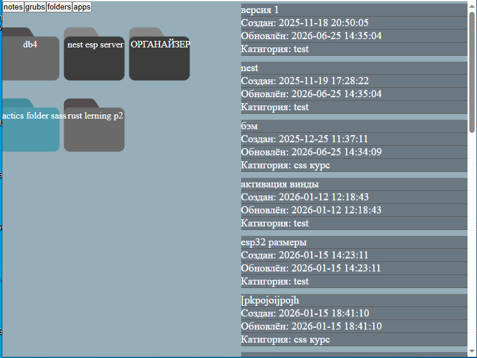
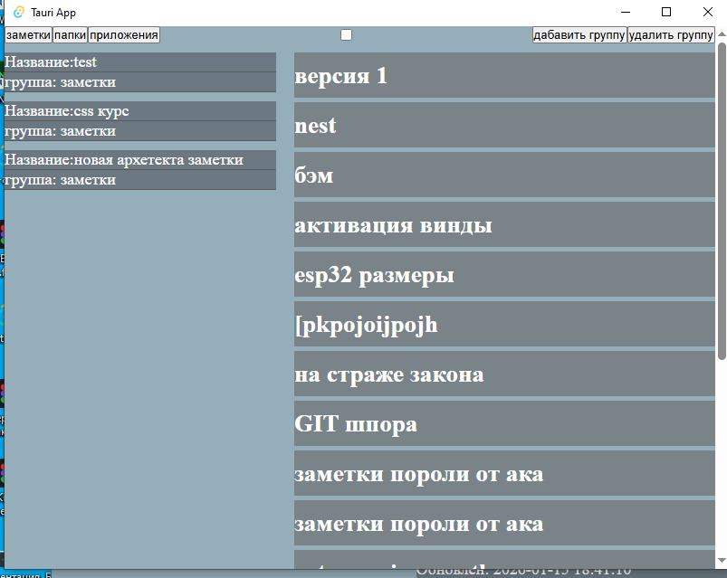

# ПЕРЕХОДНЫЙ ЭТАП И ПРАКТИКА НОВЫХ ИНСТРУМЕНТОВ 
> _«V2 — это связующий мост между Electron-прототипом и полноценной архитектурой V3. Этот этап был нужен не столько для продуктового прорыва, сколько для первичной обкатки React, TypeScript и Redux Toolkit на практике»._

## 🛠 Суть этапа

- **Главная задача:** Освоить новый стек (React + TypeScript + Redux Toolkit) и переехать с Electron на Tauri (подробный разбор причин перехода и сравнение бандлов описаны во вводном документе проекта).
    
- **Свобода от лишнего:** Вырезан неактуальный функционал (Telegram-бот) и сделана первая итерация менеджера категорий с привязкой групп к типам сущностей.
    
- **Первые шаги в Git:** Именно на V2 началось базовое знакомство с контролем версий и первыми коммитами.
    
## UI

## 💡 Инженерная рефлексия

С точки зрения продуктового дизайна или сложной архитектуры V2 не принёс существенного рывка — это был типичный «переходный» пет-проект для набивания рук на новом инструментарии. Однако именно этот практический опыт позволил осознать ограничения текущего подхода и подготовить фундамент для полноценной FSD-Lite архитектуры и SQLite-схемы в V3.

* 🔗 **[Посмотреть архивный код V2](https://github.com/bobr2026/productivity-desktop-app-v2)**
